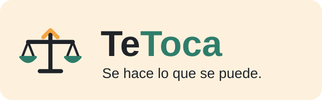

<p align="center">
  
</p>

<p align="center"><strong>Se hace lo que se puede.</strong></p>

# TeToca

Aplicación para pisos compartidos que reparte las tareas del hogar de forma equitativa. Cada tarea tiene una dificultad (1–3) que se convierte en puntos al completarla, y un ranking mensual muestra quién está aportando más.

## Funcionalidades

- Registro con el código de un piso existente o creación de un piso nuevo con su catálogo de tareas.
- Reparto semanal automático y equilibrado según la dificultad de las tareas.
- Tablero en dos vistas: por estado (pendiente / vencida / completada) y en calendario semanal.
- Asignación manual de tareas sin asignar, con fecha límite.
- Solicitudes de cambio entre convivientes (aceptar / rechazar).
- Ranking mensual de puntos.
- Aviso de tareas atrasadas.
- Roles `ADMIN` y `CONVIVIENTE`: cada conviviente solo accede a los datos de su piso.

## Tecnologías

| Capa | Tecnología |
|---|---|
| Backend | Java 26, Spring Boot 4 (Web MVC, Data JPA, Validation, Security) |
| Base de datos | PostgreSQL 17 en Docker, migraciones con Flyway |
| Documentación API | springdoc-openapi (Swagger UI) |
| Frontend | React + Vite |

## Puesta en marcha

Requisitos: Docker Desktop, JDK 26 y Node.js.

**1. Base de datos**

```bash
docker compose up -d
```

PostgreSQL queda disponible en `localhost:5433`. Flyway crea las tablas y los datos de ejemplo al arrancar el backend.

**2. Backend**

```bash
./mvnw spring-boot:run
```

- API: `http://localhost:8080/api`
- Swagger UI: `http://localhost:8080/swagger-ui.html`

**3. Frontend**

```bash
cd frontend
npm install
npm run dev
```

Abrir `http://localhost:5173`.

Para volver a los datos de demo iniciales: `docker compose down -v` y `docker compose up -d`.

## Usuarios de prueba

| Usuario | Contraseña | Piso (código) |
|---|---|---|
| `admin` | `admin1234` | Administrador global |
| `lucia`, `javi`, `nerea`, `oscar` | `1234` | Lavapiés 23 (`LAVAP-2026`) |
| `ana`, `luis`, `marta` | `1234` | Calle Luna 5 (`LUNA5`) |

## Estructura del backend

```
src/main/java/com/pisocompartido/backendtetoca
├── config        Seguridad, CORS, filtro de peticiones, control de acceso por piso
├── controller    Rutas REST
├── dto           Datos de entrada y salida de la API (con validación)
├── exception     Manejador global de errores
├── model         Entidades JPA
├── repository    Acceso a datos (consultas derivadas y JPQL)
└── service       Lógica de negocio
src/main/resources/db/migration   Migraciones Flyway (V1–V7)
```

## Principales rutas de la API

| Método | Ruta | Descripción |
|---|---|---|
| POST | `/api/auth/registro` | Registro (pública) |
| GET | `/api/auth/yo` | Usuario identificado |
| POST | `/api/pisos` | Crear piso (ADMIN) |
| GET | `/api/pisos/{id}` | Datos del piso |
| GET / POST | `/api/pisos/{pisoId}/convivientes` | Listar / añadir convivientes |
| GET | `/api/pisos/{pisoId}/convivientes/ranking` | Ranking mensual |
| GET / POST | `/api/pisos/{pisoId}/tareas` | Listar / crear tareas |
| GET | `/api/pisos/{pisoId}/asignaciones?estado=` | Asignaciones del piso |
| POST | `/api/pisos/{pisoId}/reparto` | Repartir tareas de la semana |
| POST | `/api/tareas/{tareaId}/asignaciones` | Asignar tarea manualmente |
| PATCH | `/api/asignaciones/{id}/completar` | Completar tarea |
| POST | `/api/asignaciones/{id}/solicitudes` | Pedir cambio a un compañero |
| GET | `/api/solicitudes/recibidas` | Solicitudes recibidas |
| PATCH | `/api/solicitudes/{id}/aceptar` · `/rechazar` | Responder solicitud |

Todas las rutas, salvo el registro y Swagger, requieren autenticación HTTP Basic.
